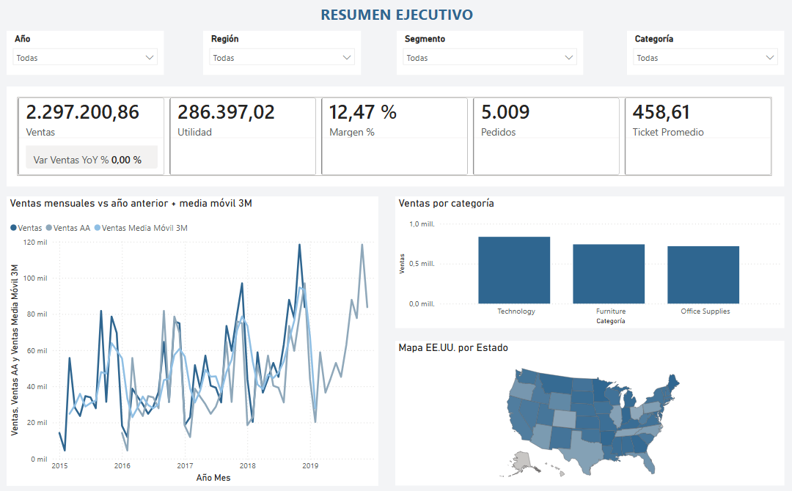
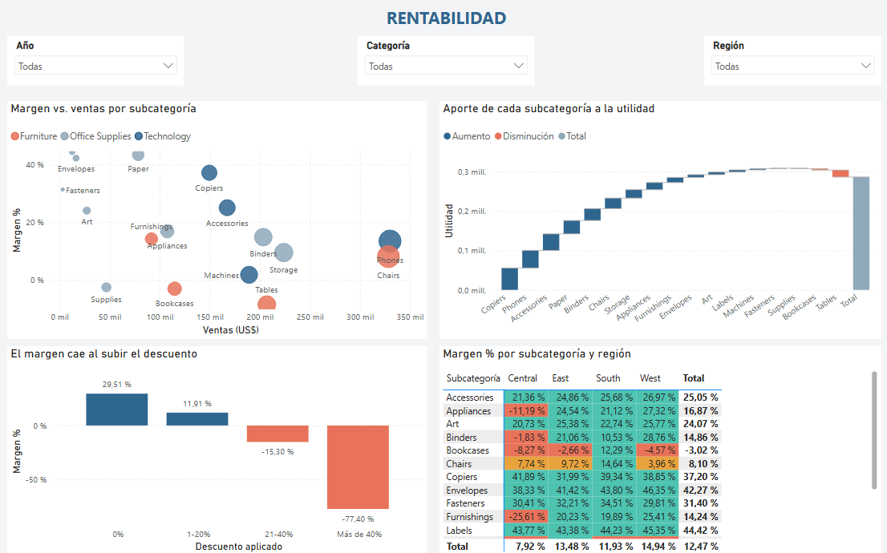
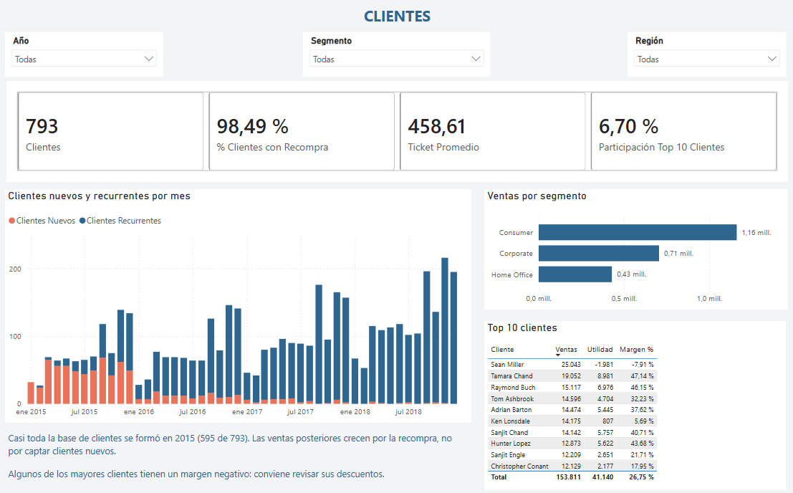
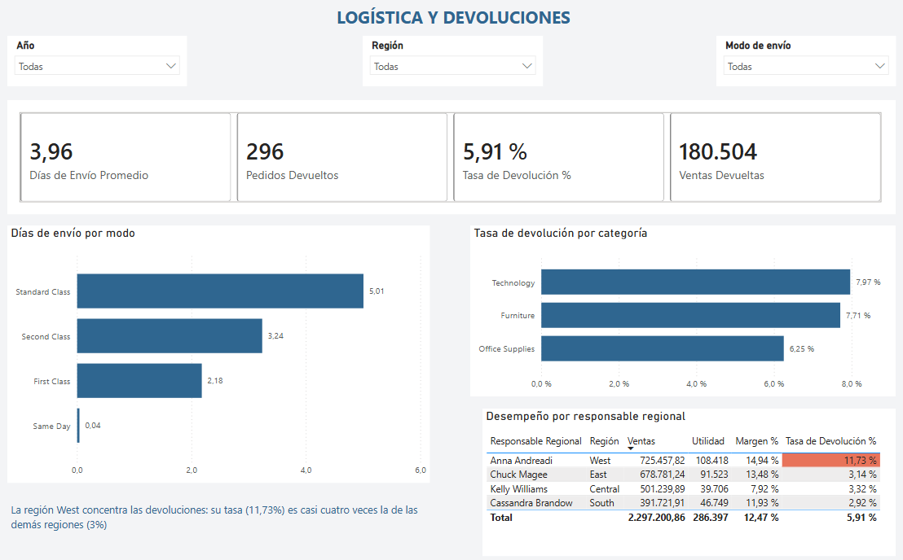
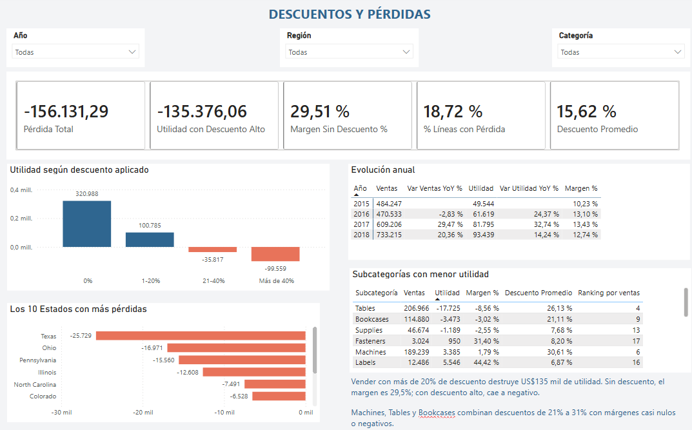

# Superstore · Power BI Sales & Profitability Dashboard

Business-intelligence project: raw retail data → cleaned **star-schema** model → **DAX measures** → a 4-page Power BI report focused on *where the business makes and loses money*.

🇪🇸 Versión en español: [README.es.md](README.es.md)

> **Status:** finished. The report (`powerbi/Superstore-dashboard.pbix`) has 5 pages; the key measures were validated against values computed independently in pandas ([docs/expected_values.md](docs/expected_values.md)).

## Business questions
1. How are sales and profit evolving year over year?
2. Which categories, sub-categories, regions and states destroy margin?
3. What is the real cost of discounting?
4. Who are the customers (new vs. recurring, top 10 concentration)?
5. How do shipping modes and returns behave?

## What the data says
(All numbers are computed from the cleaned data, 2015–2018, 9,994 order lines, 5,009 orders, 793 customers.)

- Sales **$2.30M**, profit **$286K**, margin **12.5%**. Sales +29.5% in 2017 and +20.4% in 2018.
- **Discounts drive the losses**: lines without discount earn a 29.5% margin; between 20–40% the margin is −15%, and above 40% it is −77%. Lines discounted more than 20% lose **$135K** in total.
- **Furniture is the weak spot**: 2.5% margin vs. ~17% for Technology and Office Supplies. *Tables* (−8.6%), *Bookcases* (−3.0%) and *Supplies* (−2.6%) lose money.
- **Geography**: Central region margin is 7.9% vs. 14.9% in West; Texas (−$25.7K) and Pennsylvania (−$15.6K) are loss-making states.
- 18.7% of order lines are loss-making; 5.9% of orders were returned.

## Repository structure
```
data/raw/            original CSV (Superstore sample dataset)
data/model/          cleaned star schema (5 CSV files)
src/build_model.py   cleaning + modelling (pandas)
src/expected_values.py  expected values for validating DAX
powerbi/             Superstore-dashboard.pbix · measures.dax
docs/                data model, report pages, cleaning report, validation values
screenshots/         report pages (PNG)
```

## Report preview

**1 · Executive summary** — KPIs with year-over-year variation, monthly sales vs. prior year with a 3-month moving average, sales by category and a state map.


**2 · Profitability** — margin vs. sales by sub-category, profit waterfall, margin by discount band and a sub-category × region matrix with conditional formatting.


**3 · Customers** — new vs. returning customers, repurchase rate, top-10 concentration and top customers.


**4 · Logistics & returns** — shipping days by mode, return rate by category and by regional manager (West concentrates returns: 11.7% vs. ~3% elsewhere).


**5 · Discounts & losses** — profit by discount band, annual evolution, the 10 loss-making states and the sub-categories with the lowest profit.


## How to explore it
- **See the report:** open `powerbi/Superstore-dashboard.pbix` in Power BI Desktop, or look at the screenshots above. A page-by-page description is in [docs/report_pages.md](docs/report_pages.md).
- **Data model and cleaning:** [docs/data_model.md](docs/data_model.md) (star schema and relationships) and [docs/cleaning_report.md](docs/cleaning_report.md) (what was fixed and why).
- **DAX:** all measures are documented in [powerbi/measures.dax](powerbi/measures.dax).
- **Validation:** [docs/expected_values.md](docs/expected_values.md) lists control values computed independently with pandas.
- **Regenerate the data model:** `python3 src/build_model.py` (needs pandas). If the `.pbix` asks for the data location, point it to `data/model`.

## Skills demonstrated
Data cleaning and modelling (Python/pandas) · dimensional modelling · DAX (time intelligence, `USERELATIONSHIP`, `RANKX`, `TOPN`, dynamic titles, conditional formatting) · Power Query (M) · dashboard design and storytelling · data validation.

## Dataset
Sample Superstore (fictional US retailer, 2015–2018), a public sample dataset popularised by Tableau. Copy used: [leonism/sample-superstore](https://github.com/leonism/sample-superstore).
