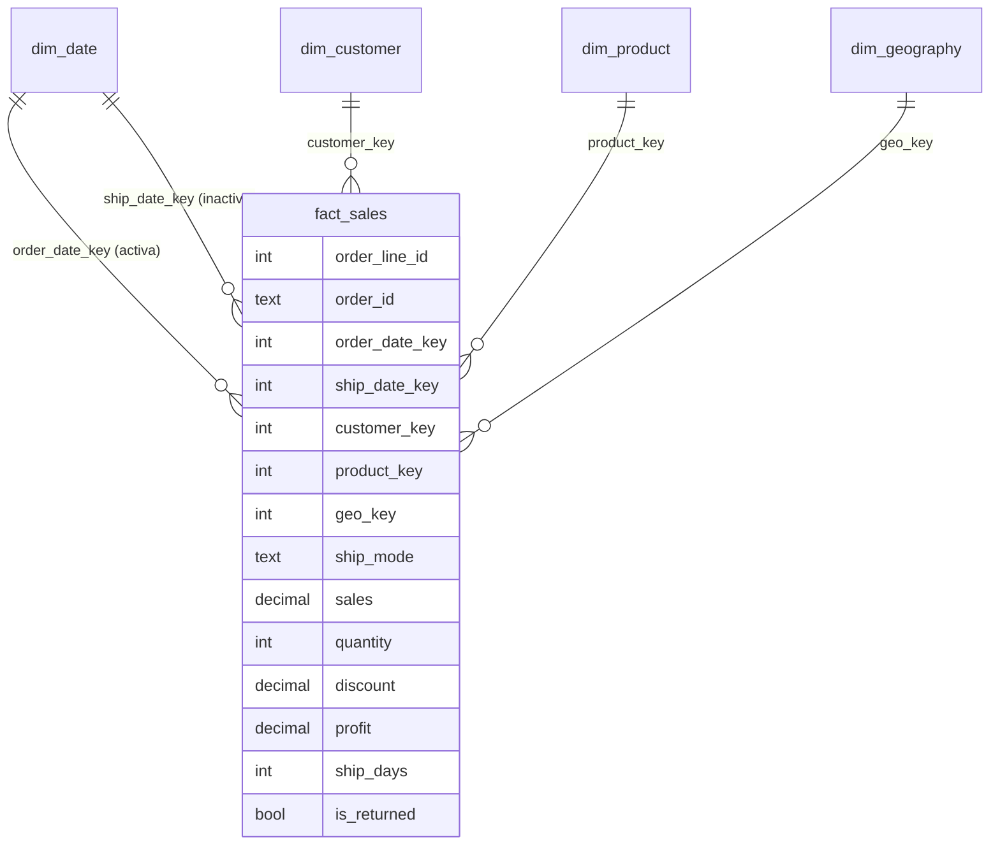

# Modelo de datos

Esquema en estrella. Granularidad de `fact_sales`: **una fila por línea de pedido** (9.994 filas).

## Relaciones en el modelo de Power BI

| Desde (muchos) | Hacia (uno) | Estado | Dirección |
|---|---|---|---|
| fact_sales[order_date_key] | dim_date[date_key] | **Activa** | Única |
| fact_sales[ship_date_key] | dim_date[date_key] | Inactiva (se usa con `USERELATIONSHIP`) | Única |
| fact_sales[customer_key] | dim_customer[customer_key] | Activa | Única |
| fact_sales[product_key] | dim_product[product_key] | Activa | Única |
| fact_sales[geo_key] | dim_geography[geo_key] | Activa | Única |

Configuración del modelo:
- `dim_date` está marcada como tabla de fechas (columna `date`) y `month_name` se ordena por `month`.
- La columna `Banda de Descuento` se ordena por `Banda de Descuento Orden` para respetar el orden de los tramos.
- `dim_geography[state]` tiene categoría de datos "Estado o provincia" para el mapa.
- Las claves (`*_key`) están ocultas en el panel de campos.
- Todas las medidas viven en una tabla `_Medidas`, y `SelectorMétrica` es una tabla desconectada para el selector de métrica.

## Decisiones de limpieza

Ver [cleaning_report.md](cleaning_report.md). Resumen: el CSV original trae pegadas las hojas de devoluciones y responsables regionales (806 filas), se separan y se usan como `is_returned` y `regional_manager`; los códigos postales se tratan como texto (los de Nueva Inglaterra empiezan con 0); 11 códigos postales faltantes (Burlington, VT) se completan; 32 `Product ID` con más de un nombre se unifican al nombre más frecuente.
